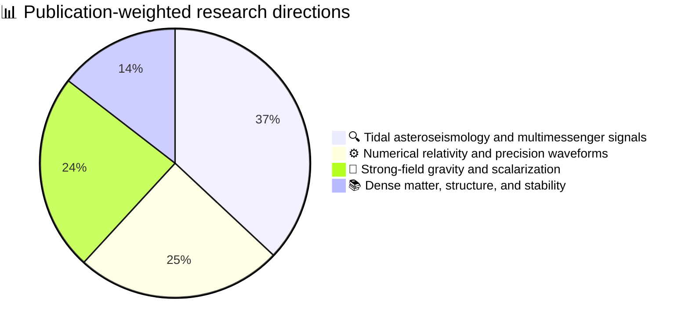

# Reading neutron stars through gravity and light

_Hao-Jui Kuan — research profile based on 25 unique full-text papers (2020–2026), updated 5 August 2026_

---

## 🎯 Research vision

I study how neutron stars reveal what they are made of—and whether gravity follows Einstein—through the signals they emit before, during, and after coalescence. My research connects relativistic stellar oscillations, gravitational-wave modelling, numerical relativity, strong-field tests of gravity, and high-energy transients. The common goal is to turn compact-object dynamics into measurements: of the nuclear equation of state, stellar spin and stratification, nonlinear tidal physics, and possible departures from general relativity.

This programme spans analytic theory, perturbative calculations, quasiequilibrium initial data, fully relativistic simulations, waveform construction, detector forecasts, and multimessenger interpretation. Within the 25 unique papers available here, I am first author on 13 and second author on 7. Together, these works form a connected research strategy: identify a physical effect, predict its observable signature, quantify the modelling uncertainty, and determine what a future detection—or a principled nondetection—would teach us.

## 📊 Portfolio balance

The proportions below are a transparent proxy for sustained research effort. Each unique paper contributes one unit, divided fractionally among five technical themes according to its central questions, methods, and results. For this public-facing profile, tidal/oscillation work and its high-energy counterparts are combined into one multimessenger direction. Duplicate files are counted once, and authorship order is not used as a numerical weight because a byline alone does not measure time or intellectual contribution.

| Research direction | Equivalent papers | Portfolio share |
| --- | ---: | ---: |
| **Tidal asteroseismology and multimessenger signals** | 9.26 | 37.0% |
| **Numerical relativity and precision waveforms** | 6.20 | 24.8% |
| **Strong-field gravity and scalarization** | 5.92 | 23.7% |
| **Dense matter, structure, and stability** | 3.62 | 14.5% |

The relative length of the four sections below follows the same balance. Because many papers bridge two or more themes, the fractions describe a connected portfolio rather than isolated silos.

## 🔍 Tidal asteroseismology and multimessenger signals — 37.0%

### Reading the final seconds before merger

My largest research direction treats a neutron star as a resonant detector of its companion. During inspiral, the orbital frequency sweeps through the star's natural modes. The resulting excitation can alter the gravitational waveform, stress or fracture the crust, redistribute angular momentum, and seed electromagnetic activity. My first-author papers developed the general-relativistic g-mode and crust-breaking framework in a [theoretical study of tidal resonances](2020-21/stab1898.pdf) and applied it to [short-gamma-ray-burst precursor timings and energetics](2020-21/stab2658.pdf). These studies showed that modes with small orbital backreaction can nevertheless reach crust-breaking amplitudes, creating a route from internal fluid physics to observable premerger flares.

The same idea becomes an inference tool when several messengers are combined. My work on [equation-of-state groups from g-mode asteroseismology](2022-23/stac1101.pdf) found that cold-star mode spectra separate into distinct dense-matter families and developed relations connecting g-mode frequencies to tidal deformability, radius, f-mode frequency, and central sound speed. A study of [double precursors as a spin diagnostic](2022-23/aa46658-23.pdf) showed how two candidate mode resonances can constrain a neutron star's rotation; for GRB 090510, the model favours a few hertz and allows roughly 2–20 Hz once mode identification and geometry are varied. These are model-dependent inferences, but they demonstrate how timing information can become stellar spectroscopy.

The waveform itself carries complementary mode information. My first-author study constructed a model of [spin-dependent f-mode imprints](2022-23/PhysRevD.106.064052.pdf), where rapid rotation can make the dynamical-tide phase exceed 100 radians and invalidate the otherwise useful equation-of-state universality. A follow-up first-author study compressed this physics into a [tidal form factor for the last three seconds of inspiral](2022-23/PhysRevD.108.063026.pdf), exposing how neglected dynamical tides can bias the inferred tidal deformability. Fully relativistic simulations have now confirmed the nonlinear importance of this channel: in our [high-precision numerical-relativity study of tidal resonance](2024-25/j3zk-z17h.pdf), an extreme retrograde-spin binary underwent resonance locking, changed the stellar spin by about 33% in the nonlinear regime, and accumulated up to about 40 radians of gravitational-wave dephasing.

### Connecting crust failure to high-energy emission

My multimessenger work follows the energy beyond the stellar mode. A study of [quasi-periodic oscillations as seismic aftershocks](2022-23/aa44082-22.pdf) interpreted the statistically secure 22 Hz feature (+3/−2 Hz) in the precursor of GRB 211211A as consistent with a crustal torsional mode, with a tentative 51 Hz feature consistent with a higher multipole. A later calculation of [oscillations in stratified stars with solid crusts](2024-25/nbk7-8kts.pdf) treated elasticity and composition together, finding that nonresonant f- and shear-mode forcing can fracture the crust near a gravitational-wave frequency of 200 Hz and make roughly 10⁴⁶ erg available in crust-confined motion by 300 Hz. The quantitative conversion of that mechanical energy into gamma rays remains uncertain, but the calculation narrows the physical interface between mode theory and transient observations.

Tidal motion may also reorganise the magnetic field before merger. Our model of [resonance-induced magnetorotational instability](2024-25/PhysRevD.109.103023.pdf) predicts that low-order g-modes can create differential rotation in the crust and amplify fields above 10¹³ G on millisecond timescales for sufficiently rapid spins. The broader [review of premerger phenomena](2024-25/universe-10-00441.pdf) places this mechanism alongside crust failure, magnetospheric interaction, shocks, dynamos, and other proposed engines; its central lesson is that the observed precursor population is unlikely to have a single origin. Beyond mergers, my collaboration on [magnetar-powered neutrinos](2024-25/Brdar_2024_J._Cosmol._Astropart._Phys._2024_026.pdf) showed how source magnetic fields could make neutrino magnetic moments as small as 10⁻¹² μB—and, under favourable geometry, smaller—visible through flavour and Glashow-resonance signatures at IceCube.

### Future direction

The next step is a self-consistent model of the final seconds that connects orbital dynamics to realistic stellar microphysics and then to an observable transient. I aim to combine finite-temperature composition gradients, a solid and plastically yielding crust, superfluid and superconducting components, magnetic geometry, reaction and diffusion timescales, and nonlinear mode coupling. Long, low-eccentricity relativistic simulations beginning early enough to capture low-frequency g- and interface-mode resonances will provide calibration points for faster waveform and population models. The goal is not merely to fit a precursor time, but to predict jointly the gravitational-wave phase, fracture location, magnetic amplification, energy release, and post-fracture evolution.

On the observational side, homogeneous precursor catalogues and coordinated gravitational-wave, gamma-ray, radio, X-ray, neutrino, kilonova, and afterglow analyses can help break degeneracies among spin, equation of state, magnetic field, mode identity, and jet delay. Next-generation interferometers could make many currently small mode effects measurable in the phase, while IceCube-Gen2 and wide-field transient facilities can test whether the same systems produce high-energy counterparts. This creates a path from individual candidate events to population-level neutron-star asteroseismology.

## ⚙️ Numerical relativity and precision waveforms — 24.8%

Numerical accuracy is part of the physics: a waveform cannot reveal a subtle tide or modification of gravity if its uncertainty is larger than the signal. My [error-budget study of highly spinning binary neutron stars](2024-25/2506.02115v1.pdf) isolated uncertainties from extraction radius, grid resolution, evolution code, and initial-data solver. FUKA and SGRID initial data evolved with the same code remained within about 0.02 radians during inspiral, while the SACRA-MPI–BAM difference reached roughly 1.6–2.2 radians near merger. Current analytic models differed from the simulations by as much as about 4 radians, outside the estimated numerical budget. The study found that initial-data choice alone cannot explain the discrepancy and identified several candidate causes: missing higher-multipole finite-size terms, inadequate post-contact modelling, and assumptions inherited from binary-black-hole baselines.

This precision programme also tests the physical assumptions inside waveform models. The fully relativistic [nonlinear tidal-resonance simulation](2024-25/j3zk-z17h.pdf) provides an unusually demanding calibration point for dynamical tides. Earlier analytic work on [spin-dependent f-mode phasing](2022-23/PhysRevD.106.064052.pdf) and the [tidal form factor](2022-23/PhysRevD.108.063026.pdf) supplies efficient descriptions for inference, while the simulation identifies where linear-response models cease to be adequate. In modified gravity, [scalar–Gauss–Bonnet merger evolutions](2022-23/PhysRevD.108.063033.pdf), [massive scalar-tensor quasiequilibria](2022-23/PhysRevD.108.064057.pdf), and [postmerger-remnant simulations](2024-25/PhysRevD.110.104018.pdf) extend the same numerical infrastructure to waveforms with new degrees of freedom.

Long-lived remnants pose a different accuracy challenge. Our [convective-stability analysis of massive merger remnants](2024-25/w8gq-3d54.pdf) followed three systems for about 120 ms, found neither large-scale convection nor an observable inertial-mode signal, and showed that a growing one-arm feature was strongly correlated with linear-momentum violation. This result raised a numerical-origin concern rather than settling the mode's identity, and it identifies a conservation problem that future mesh-refinement methods must solve before the feature receives an astrophysical interpretation.

Across these projects, the modelling chain extends from theory-consistent initial data and eccentricity reduction to adaptive-mesh evolution, radiation extraction, convergence tests, and comparisons with fast waveform approximants. That end-to-end perspective makes discrepancies diagnostically useful. Agreement between independent initial-data solvers can rule out one source of error; resolution and extraction studies bound others; cross-code comparisons expose implementation-sensitive dynamics; and the remaining residual against an analytic model identifies physics that the model may lack. The same discipline applies when a surprising postmerger mode appears: conservation checks and symmetry-preserving tests must precede astrophysical interpretation.

My future work in this direction will expand cross-code benchmarks across mass ratio, equation of state, aligned and retrograde spin, and postmerger lifetime. Waveform models need high-spin current multipoles, higher-order finite-size effects, nonlinear dynamical tides, cleaner treatment after contact, and explicit tests of whether black-hole horizon-absorption terms inherited from baseline models are appropriate for neutron stars. In parallel, long postmerger simulations need finite-temperature equations of state, neutrino transport, magnetic fields, and explicitly momentum-conserving refinement. The payoff is a waveform error budget that remains trustworthy as detector sensitivity improves—and that lets us distinguish missing astrophysical physics from gravity beyond general relativity.

## 🧪 Strong-field gravity and scalarization — 23.7%

My second major scientific pillar uses dynamical compact stars to test gravity in regimes inaccessible to weak-field experiments. Early work established a [viability condition for scalar–tensor frame transformations](2020-21/Geng_2020_Class._Quantum_Grav._37_115001.pdf) and applied it to the [inverse-chirp scalar signal from core collapse](2020-21/s10052-020-8359-y.pdf). Subsequent simulations studied [triple-scalar interactions in massive scalar–tensor collapse](2020-21/Huang_2021_Class._Quantum_Grav._38_245006.pdf), the [dynamical formation of scalarized neutron stars and black holes](2020-21/PhysRevLett.127.161103.pdf), and the [nonlinear stability and nonuniqueness of scalarized stars](2020-21/PhysRevD.104.124013.pdf). Together, these works move from mathematical consistency to formation channels, waveform morphology, and nonlinear outcomes.

Binary dynamics open additional strong-field transitions. My study of [accretion-induced descalarization](2022-23/PhysRevLett.129.121104.pdf) showed that a scalarized star can migrate to a weakly scalarized branch rather than collapse, releasing a dispersive monopole signal potentially visible over very long times. In [scalar–Gauss–Bonnet binary mergers](2022-23/PhysRevD.108.063033.pdf), the companion lowered the scalarization threshold by about 11% in a near-equal-mass example. For [massive scalar-tensor quasiequilibrium binaries](2022-23/PhysRevD.108.064057.pdf), interacting scalar clouds accelerated the inspiral and motivated a prospective lower bound near 10⁻¹¹ eV on the scalar mass for strongly scalarized stars.

The postmerger regime exposes the degeneracy between new gravity and uncertain matter. Our [massive scalar-tensor remnant study](2024-25/PhysRevD.110.104018.pdf) found that scalarization can raise the prompt-collapse threshold by roughly 0.1–0.2 solar masses, while descalarization can shift the dominant postmerger frequency in a way that resembles a dense-matter phase transition. Work on [extreme rotators in massive scalar-tensor theory](2024-25/PhysRevD.111.104030.pdf) supported the mass turning point as a practical axisymmetric stability diagnostic. A catalogue of about 120 simulations then demonstrated [departures from general-relativistic waveform relations](2024-25/PhysRevLett.134.151402.pdf), including postmerger-frequency deviations above 10% in some cases, while showing that such deviations are not uniquely attributable to modified gravity.

The observational strategy is deliberately redundant. A massive scalar can alter the inspiral binding energy, radiate in monopole or dipole channels, delay or accelerate collapse, leave an oscillating cloud around a remnant, and move its spectral peaks. Dense-matter physics can reproduce some, but not all, of these effects. Combining channels therefore provides a stronger test than assigning discovery status to a single anomalous frequency. Equally important, nondetections can exclude the coupling needed to trigger scalarization in a measured binary, provided that stellar masses, spins, and matter uncertainty are propagated consistently.

The future challenge is therefore joint inference rather than signature hunting in isolation. I aim to produce fully backreacting, three-dimensional merger and collapse waveforms across broader scalar couplings, masses, spins, equations of state, and finite-temperature microphysics. Gravity-aware universal relations and theory-parameterised waveform models can then be confronted with next-generation observations. Combining inspiral, prompt-collapse threshold, postmerger spectrum, scalar radiation, and electromagnetic counterparts is designed to test whether scalarization, nuclear phase transitions, and conventional modelling error can be separated instead of allowing one to masquerade as another.

## 📚 Dense matter, structure, and stability — 14.5%

Dense-matter physics is a cross-cutting target rather than an isolated application. The [g-mode equation-of-state study](2022-23/stac1101.pdf) grouped 20 equations of state through their stratified spectra and linked those modes to radius, tidal deformability, and central sound speed. The [solid-crust oscillation calculation](2024-25/nbk7-8kts.pdf) showed how elasticity changes mode identity and crust penetration. The [scalar-tensor universal-relation catalogue](2024-25/PhysRevLett.134.151402.pdf) demonstrated that gravity and phase-transition effects can shift the same observables, while the [axisymmetric stability study](2024-25/PhysRevD.111.104030.pdf) and [long-lived remnant analysis](2024-25/w8gq-3d54.pdf) tested how rotation, scalar support, thermal gradients, and numerical conservation govern the survival of massive stars.

These calculations treat the equation of state not as a label but as a collection of measurable consequences. Composition gradients set buoyancy and the g-mode spectrum; elasticity controls whether motion penetrates or fractures the crust; tidal deformability shapes the inspiral; thermal pressure and differential rotation support the remnant; and central sound speed or phase structure changes its characteristic frequencies. Following several observables through the same physical model is essential because any one of them can be degenerate with spin, temperature, magnetic field, or gravity theory. A consistent combination can instead cross-check the inferred stellar structure.

Future work will bring these threads into a shared inference framework. Realistic finite-temperature tables, composition evolution, neutrino transport, superfluidity, superconductivity, elastic and plastic crust dynamics, and possible exotic phases must be propagated consistently from stellar structure into inspiral and postmerger observables. Broader equation-of-state catalogues and three-dimensional stability calculations can identify which relations remain universal, which are gravity dependent, and which observables most cleanly separate hadronic structure from new degrees of freedom. A near-term deliverable is a gravity-aware inference map joining inspiral deformability, mode frequencies, collapse threshold, and remnant spectrum under shared microphysical assumptions.

## 👥 Research outlook

The long-term opportunity is to make the neutron-star merger a controlled experiment rather than a single spectacular event. My work links the star's internal oscillations to the orbit, the orbit to gravitational waves, the crust and magnetic field to high-energy transients, and the remnant to strong-field gravity and dense matter. I am especially interested in collaborations that connect analytic theory with numerical relativity, or simulations with joint gravitational-wave and electromagnetic inference. The aim is a predictive, uncertainty-aware account of the entire coalescence—from the first resonant warning before merger to the final state of the remnant.

## 🔗 Evidence base and update policy

This living profile is based on every distinct research PDF currently available in the repository: 25 unique papers spanning 423 PDF pages. Ten files under `2026-27/` are byte-identical copies of files under `2024-25/` and are counted once. A listed nonlinear-saturation paper currently reuses the PDF of the 2025 tidal-resonance paper, while two newer titles have no local PDFs; none of those title-only records is used for claim-level synthesis. When a distinct full text is added, the paper should receive one unit of fractional topic weight, the totals should be recomputed, and the prose balance should be updated.

<strong>📚 Full reviewed corpus</strong>

The final column is the reproducible allocation ledger. Each row sums to 1.00: **T** is tidal asteroseismology plus high-energy multimessenger work, **N** is numerical relativity and precision waveforms, **G** is strong-field gravity and scalarization, and **D** is dense matter, structure, and stability.

| Year | Paper | Authorship | Weights (T / N / G / D) |
| ---: | --- | --- | ---: |
| 2026 | [Convective stability analysis of massive neutron stars formed in binary mergers](2024-25/w8gq-3d54.pdf) | Fifth | 0.05 / 0.65 / 0.00 / 0.30 |
| 2025 | [The error budget of binary neutron star merger simulations for configurations with high spin](2024-25/2506.02115v1.pdf) | First | 0.10 / 0.85 / 0.00 / 0.05 |
| 2025 | [Tidal Resonance in Binary Neutron Star Inspirals: A High-Precision Study in Numerical Relativity](2024-25/j3zk-z17h.pdf) | First | 0.65 / 0.30 / 0.00 / 0.05 |
| 2025 | [Nonradial oscillations of stratified neutron stars with solid crusts](2024-25/nbk7-8kts.pdf) | Second | 0.65 / 0.05 / 0.00 / 0.30 |
| 2025 | [Axisymmetric stability of neutron stars as extreme rotators in massive scalar-tensor theory](2024-25/PhysRevD.111.104030.pdf) | Third | 0.00 / 0.25 / 0.45 / 0.30 |
| 2025 | [Accessing Universal Relations of Binary Neutron Star Waveforms in Massive Scalar-Tensor Theory](2024-25/PhysRevLett.134.151402.pdf) | Third | 0.00 / 0.40 / 0.45 / 0.15 |
| 2024 | [Magnetic amplification in premerger neutron stars](2024-25/PhysRevD.109.103023.pdf) | Second | 0.90 / 0.05 / 0.00 / 0.05 |
| 2024 | [Magnetar-powered neutrinos and magnetic moment signatures at IceCube](2024-25/Brdar_2024_J._Cosmol._Astropart._Phys._2024_026.pdf) | Third | 0.95 / 0.00 / 0.00 / 0.05 |
| 2024 | [Binary neutron star mergers in massive scalar-tensor theory: Postmerger remnants](2024-25/PhysRevD.110.104018.pdf) | Second | 0.05 / 0.45 / 0.40 / 0.10 |
| 2024 | [Premerger Phenomena in Neutron Star Binary Coalescences](2024-25/universe-10-00441.pdf) | Second | 0.75 / 0.08 / 0.02 / 0.15 |
| 2023 | [Last three seconds: Packed message delivered by tides](2022-23/PhysRevD.108.063026.pdf) | First | 0.45 / 0.45 / 0.00 / 0.10 |
| 2023 | [Binary neutron star mergers in massive scalar-tensor theory: Quasiequilibrium states](2022-23/PhysRevD.108.064057.pdf) | First | 0.00 / 0.40 / 0.50 / 0.10 |
| 2023 | [Dynamical scalarization during neutron star mergers in scalar-Gauss-Bonnet theory](2022-23/PhysRevD.108.063033.pdf) | First | 0.00 / 0.40 / 0.50 / 0.10 |
| 2023 | [Measuring spin in coalescing binaries that show double precursors](2022-23/aa46658-23.pdf) | First | 0.85 / 0.05 / 0.00 / 0.10 |
| 2022 | [Gravitational Waves from Accretion-Induced Descalarization](2022-23/PhysRevLett.129.121104.pdf) | First | 0.20 / 0.20 / 0.40 / 0.20 |
| 2022 | [Constraining equation-of-state groups from g-mode asteroseismology](2022-23/stac1101.pdf) | First | 0.50 / 0.05 / 0.00 / 0.45 |
| 2022 | [f-mode imprints on gravitational waves from spinning neutron-star binaries](2022-23/PhysRevD.106.064052.pdf) | First | 0.52 / 0.40 / 0.00 / 0.08 |
| 2022 | [Quasi-periodic oscillations in precursor flares via seismic aftershocks](2022-23/aa44082-22.pdf) | Second | 0.85 / 0.00 / 0.00 / 0.15 |
| 2021 | [Nonlinear evolution and nonuniqueness of scalarized neutron stars](2020-21/PhysRevD.104.124013.pdf) | First | 0.00 / 0.25 / 0.55 / 0.20 |
| 2021 | [Dynamical Formation of Scalarized Black Holes and Neutron Stars](2020-21/PhysRevLett.127.161103.pdf) | First | 0.10 / 0.30 / 0.55 / 0.05 |
| 2021 | [Scalar gravitational-wave signals from core collapse with triple-scalar interactions](2020-21/Huang_2021_Class._Quantum_Grav._38_245006.pdf) | Third | 0.18 / 0.30 / 0.45 / 0.07 |
| 2021 | [General-relativistic treatment of tidal g-mode resonances—Part I](2020-21/stab1898.pdf) | First | 0.65 / 0.10 / 0.00 / 0.25 |
| 2021 | [General-relativistic treatment of tidal g-mode resonances—Part II](2020-21/stab2658.pdf) | First | 0.75 / 0.05 / 0.00 / 0.20 |
| 2020 | [Viable constraint on scalar field in scalar-tensor theory](2020-21/Geng_2020_Class._Quantum_Grav._37_115001.pdf) | Second | 0.01 / 0.02 / 0.95 / 0.02 |
| 2020 | [Inverse-chirp imprint of gravitational-wave signals in scalar-tensor theory](2020-21/s10052-020-8359-y.pdf) | Second | 0.10 / 0.15 / 0.70 / 0.05 |

---
